<!-- Header -->

  

  

  
  
  
  
  

  

I'm a **B.Tech CSE (Data Science)** student at **Chandigarh University**, passionate about **AI, Machine Learning, Cybersecurity, and Software Development**. I build intelligent systems, automation tools, and real-world IoT solutions, and I'm always exploring new technologies and turning ideas into working projects.

  
   
  

  
  
  
  
  
  

  
  
  
  

  <a href="https://aeris-uav-twin.vercel.app">AERIS live demo ↗</a> &nbsp;·&nbsp; <a href="https://ai4students-ngo-website.vercel.app">AI4Students live site ↗</a>

  

| Certification | Issued by | Verify |
| :-- | :-- | :-: |
| 🖥️ **MIPS Computer Architecture and Performance Optimization** | BITS Pilani · Coursera | [✅ Verify](https://coursera.org/verify/JWH9H5O9JTG5) |
| 🖥️ **Introduction to Computing Systems** | BITS Pilani · Coursera | [✅ Verify](https://coursera.org/verify/ESOJYLGY2I14) |
| 📋 **Foundations of Project Management** | Google · Coursera | [✅ Verify](https://coursera.org/verify/Q1EW678CGHB3) |
| ⚙️ **Software Foundation Course: C++** | IBM Developer Skills Network | [✅ Verify](https://courses.cu.skillsnetwork.site/certificates/d97d1ca7441346dd9721e6982d081b38) |
| 🔬 **Critical Enquiry and Research Methodology** | Chandigarh University · Coursera | [✅ Verify](https://coursera.org/verify/7OWGTSVNMRVW) |
| 🚀 **Entrepreneurial Mindset: Build, Grow & Lead Your Own Venture** | Chandigarh University · Coursera | [✅ Verify](https://coursera.org/verify/8J0I6PWPPEPP) |

<b>🤖 Generative AI: 14 courses</b> (LinkedIn Learning)

 

- Generative AI: Introduction to Large Language Models
- Responsible Generative AI and Local LLMs
- Introduction to Generative Adversarial Networks (GANs)
- Introduction to Generative AI with GPT
- Generative AI for Cyber Range and Training
- HTML, CSS, and Generative AI: Speed Up Your Process
- Generative AI vs. Traditional AI
- What Is Generative AI?
- Discover the Possibilities of Generative AI
- How to Research and Write Using Generative AI Tools
- Integrating Generative AI into Business Strategy
- Generative AI for Business Leaders
- Generative AI in Learning and Development
- AI and Generative AI for Video Content Creation

<b>📊 Data, Excel &amp; Mathematics: 7 courses</b> (LinkedIn Learning)

 

- Programming Foundations: Discrete Mathematics
- Learning Everyday Math
- Excel: Macros and VBA for Beginners
- Excel Formulas and Functions Quick Tips
- Learning Excel Desktop (Microsoft 365)
- Excel: Introduction to Formatting
- Excel Quick Tips

<b>🧠 Problem Solving &amp; Professional Skills: 11 courses</b> (LinkedIn Learning)

 

- Critical Thinking and Problem Solving
- Problem-Solving Techniques
- A3 Problem Solving for Continuous Improvement
- Decision-Making Strategies
- Crafting Problem and Solution Statements
- Take a More Creative Approach to Problem-Solving
- Solving Business Problems
- Skills for Inclusive Conversations
- Leadership Strategies for Women
- Success Strategies for Women in the Workplace
- Preventing Harassment in the Workplace

  
  

  

  <picture>
    <source media="(prefers-color-scheme: dark)" srcset="https://raw.githubusercontent.com/nainanishourya/nainanishourya/output/github-snake-dark.svg" />
    <source media="(prefers-color-scheme: light)" srcset="https://raw.githubusercontent.com/nainanishourya/nainanishourya/output/github-snake.svg" />
    
  </picture>

  <b>Let's connect and build something intelligent together.</b>  
  
  

<!-- Footer -->

  

